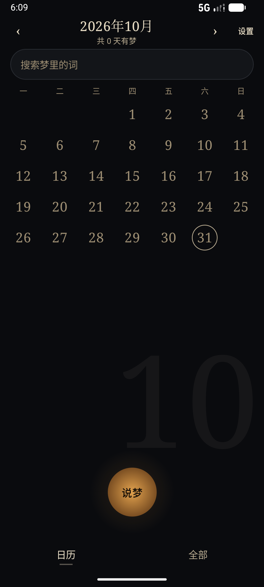
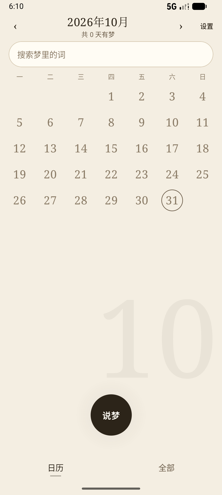

# 梦匣 DreamKeeper

一个只装在自己手机里的做梦记录 App：醒来按住说一段，它离线转成文字、把口水话整理成「原样稿」，再帮你把这场梦写成一个短篇。

 

## 为什么做这个东西

我一直记得有一阵子做过一个特别离谱的梦：剧情一层套一层，醒来那几分钟还记得清清楚楚，当时就想「这要是写成小说得多好看」。可惜那会儿没有 AI，我也不会写小说，过了没几天，细节就全忘了，只剩下「我好像做过一个很牛的梦」这种空落落的感觉。

后来不是有 AI 了嘛。再后来我开始用 DSH 做 vibe coding，越用越觉得：写代码这件事都能这么玩了，那把自己一闪而过的梦留下来，应该也不难吧？

于是就有了这个 App。它解决的不是「记录」本身——备忘录也能记录——而是记录之后那一步：把一段「呃……就是……那个……」的语音，变成一段能读的文字，再变成一个能看的故事。

## 现在它能做什么

- **按住说梦**：锁屏也能录，最长 4 小时，支持断点补录（追录接在同一段 WAV 后面）。
- **离线转写**：内置 SenseVoice Small（约 230 MB，随包安装），不联网、不依赖系统语音包，中文识别自带标点。
- **原样整理**：一个字都不改事实，只把口水话、重复和同音错字理顺，尽量保留你当时的语气。
- **小说化**：三段式（先规划故事，再写正文，最后逐行润色），写成一个 800–5000 字的短篇，并留下「创作手记」说明借用了什么、舍弃了什么、新造了什么。
- **改与回退**：原样稿能直接改；小说稿每改一次是一个版本，随时切回旧的。
- **导出**：txt / docx / pdf，带「梦匣」的小版式。
- **标签**：整理完自动打 3–6 个标签，长按能删。
- **多供应商**：DeepSeek / 小米 MiMo / MiniMax / 通义千问 / 智谱 GLM，每家一条独立 Key，可测连接、可自动探测可用模型。
- **三套皮肤**：灯下纸（暖暗）、晨光纸（明亮）、冷夜（冷暗），外加跟随系统。

## 一些我比较在意的取舍

- **没有账号，没有云**。梦和录音只在这台手机的 SQLite 和文件目录里；除了你自己配置的模型服务，没有任何上传。
- **Key 不进日志**。API Key 用 Android Keystore 加密后存在本机，日志里只出现打码后的尾巴。
- **能离线就离线**。转写是本地模型；只有「整理」和「小说化」这两步需要联网（那是真的需要大模型）。
- **不假装聪明**。整理稿如果没过自检闸门，会老实退回上一版，而不是硬编一段看起来通顺、但改了你事实的话。

## 技术栈

Kotlin + Jetpack Compose + Room（含 v1→v3 迁移与备份校验）、OkHttp、sherpa-onnx（SenseVoice Small 离线 ASR）、多供应商 OpenAI 兼容客户端，以及一套本地 Python 闸门脚本（`scripts/check-*.py`，用来在模型输出上做事实/文风自检）。

## 想自己跑一遍

需要：JDK 17（Android Studio 自带 JBR 即可）、Android SDK（compileSdk 37）、一台 Android 8.0+ 的手机。

```bash
git clone https://github.com/Shawnbow-Huang/DreamKeeper.git
cd DreamKeeper

# 1) 拉内置语音识别的二进制（AAR + 模型，共约 290 MB；按 SHA256 校验，不入库）
bash scripts/fetch-asr.sh

# 2) 构建
cd android
JAVA_HOME="/path/to/jbr" ./gradlew assembleDebug
```

release 签名是可选的：在仓库根放一个 `keystore.properties`（已被 `.gitignore` 忽略），没有就出 unsigned 包。

跑起来之后在「设置 → 模型服务」里填自己的 API Key——仓库里没有任何 Key，也不接受 PR 里提交 Key。

## 仓库里都有什么

```
DreamKeeper/
├── android/     App 本体（data/ 落库、llm/ 生成链与闸门、stt/ 离线识别、ui/ 界面）
├── prompts/     原样整理 / 小说化 / 打标签的提示词，和代码一起版本化
├── scripts/     闸门与迁移校验脚本（Python）
├── docs/        计划、设计稿、验收记录、真机截图；时间线见 docs/PROGRESS.md
└── dist/        本地打包产物（不入库，去 Releases 下）
```

## 下载

去 [Releases](https://github.com/Shawnbow-Huang/DreamKeeper/releases) 按版本号取 APK。

0.11.0 起包里带了约 239 MB 的离线语音模型，所以 APK 大约 324 MB；0.10.x 及以前没有语音模型，只有 9 MB 左右。

## 已知限制

- 只在 vivo V2405A（Android 16）和小米模拟器上做过真机验证，其他机型没测。
- 转写质量跟录音环境关系很大，安静环境下明显更准。
- 小说化的 PLAN 阶段偶尔会被模型写成不合法的 JSON；App 会重试一次，仍失败就整次失败（不吞错）。
- 暂时没有 iOS 版，也暂时没做多设备同步（故意的）。

## 关于代码和许可

这是我兴趣之下用 DSH 做 vibe coding 的产物，代码写得比较直白。欢迎读、欢迎提 issue，但**没有授权商用或直接打包上架**。

内置的 SenseVoice / sherpa-onnx 遵循它们各自的许可证，见 [THIRD-PARTY-NOTICES.md](THIRD-PARTY-NOTICES.md) 与 [MODEL-LICENSE.txt](android/app/src/main/assets/sensevoice/MODEL-LICENSE.txt)。
